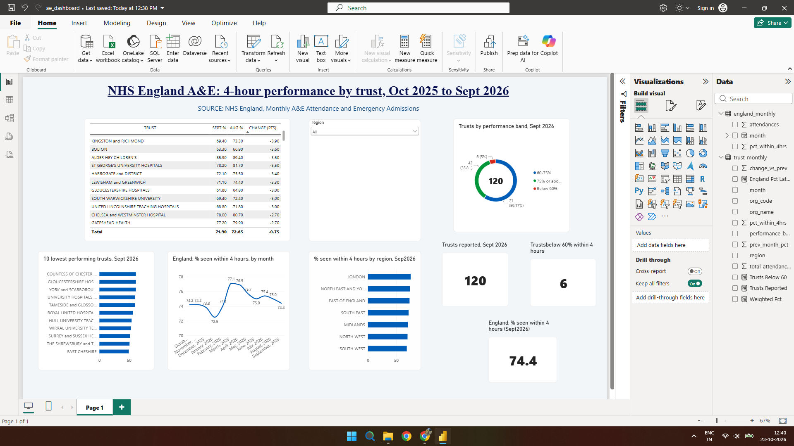

# NHS A&E 4-Hour Performance, Oct 2025 to Sep 2026

SQL and Power BI analysis of NHS England monthly A&E statistics, asking: **which NHS trusts miss the 4-hour A&E standard, and is performance improving or worsening?**

## Key findings

- England's 4-hour performance was lowest in **January 2026 (72.5%)**, peaked in **March 2026 (77.1%)**, and was **74.4% in September 2026**.
- In September 2026, 120 organisations with a major (Type 1) A&E department reported data. **6 were below 60%**, 71 were between 60% and 75%, and 43 were at 75% or above.
- The lowest-performing trust in September was **East Cheshire (49.8%)**.
- The largest one-month fall was **Birmingham Women's and Children's, from 93.7% to 78.2% (-15.5 points)**. I have not investigated the cause, and this analysis does not explain it.

These findings are descriptive only. They do not explain why any trust performs as it does.

## Data

NHS England monthly A&E attendances and emergency admissions statistics, one CSV per month, October 2025 to September 2026 (about 190 to 199 organisations per month). Source: https://www.england.nhs.uk/statistics/statistical-work-areas/ae-waiting-times-and-activity/

The data is aggregated, organisation-level and publicly released. It contains no patient-level information. NHS England statistics are published under the Open Government Licence v3.0. Raw files are not included in this repository; please download them from the source.

## Method

1. Read all 12 monthly CSVs as one table in DuckDB (SQL) using Google Colab.
2. Built a clean table: parsed text periods into dates, trimmed names, and summed all attendance and over-4-hour columns, including booked appointments.
3. Removed England TOTAL rows found in each file. One month was initially double-counted because a total row slipped through the first filter; I caught it by checking monthly attendance totals.
4. Calculated the 4-hour percentage by summing counts first and then dividing, so large trusts carry more weight than small ones.
5. Kept only organisations with Type 1 attendances when ranking hospital trusts, so walk-in centres do not distort the ranking.
6. Used a window function (LAG with PARTITION BY) to calculate each trust's month-on-month change.
7. Built a Power BI dashboard from the exported results.

## Validation

- My August 2026 attendance total (2,342,959) matches NHS England's published figure.
- My July 2026 result (75.4% within 4 hours) matches NHS England's published figure.
- September's totals match the TOTAL row in the source file.

## SQL techniques used

Wildcard multi-file reads, GROUP BY and aggregates, CAST and strptime, CTEs, window functions (LAG, PARTITION BY, ORDER BY), CASE WHEN.

## Limitations

- Monthly aggregated data cannot show why a trust performs as it does.
- The number of organisations varies by month (190 to 199), so trust comparisons use those present in each month.
- The performance bands (below 60%, 60-75%, 75% or above) are my own groupings, not official targets.
- Rankings for a single month can mislead, and trust mergers can change names and codes.

## Repository contents

- `ae_analysis.ipynb`: SQL notebook (Google Colab)
- `ae_dashboard.pbix`: Power BI dashboard (requires Power BI Desktop on Windows)
- `ae_dashboard.pdf` and `ae_dashboard.png`: dashboard export and screenshot

## Tools

Google Colab, DuckDB (SQL), Power BI Desktop
